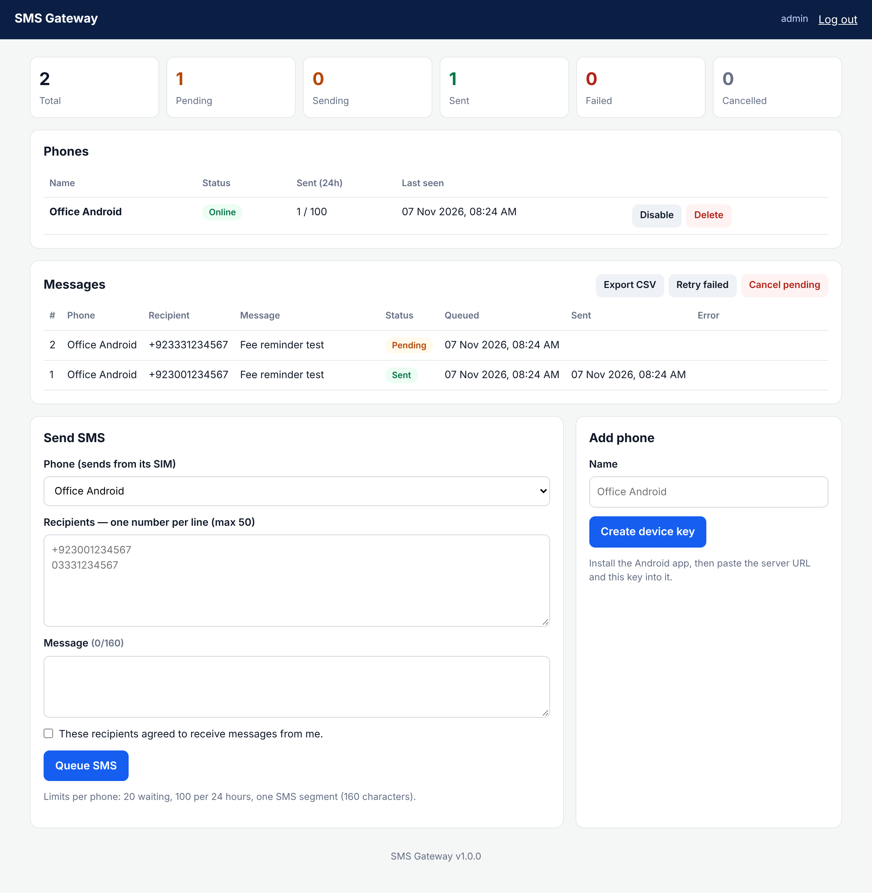

# PHP SMS Gateway

Send SMS from your own website through the SIM card of an Android phone.
No SMS provider, no monthly fee — the phone sends the messages from its own SIM, and your website shows a report of every message.

Built for **cheap shared hosting** (cPanel, PHP + MySQL). Useful for schools, tuition centres, clinics and small shops that want to send fee reminders, appointment reminders or notices to people who agreed to receive them.



## How it works

```
Website (sms.php)  ──queue──▶  MySQL  ◀──poll every 30 s──  Android app  ──SIM──▶  SMS
        ▲                                                          │
        └──────────────── sent / failed report ◀──────────────────┘
```

1. You queue messages on the website.
2. The Android app checks the website every 30 seconds and claims one message at a time.
3. The phone sends it from its SIM and reports **Sent** or **Failed** (with the reason) back to the website.

## Features

- Admin login, one-page installer, no framework, no Composer
- Several phones, each with its own secret device key (stored only as a SHA-256 hash)
- Queue up to 50 numbers at once; local numbers like `03001234567` become `+923001234567` (configurable country code)
- Live report (auto-refresh), status filter, **CSV export** for Excel, retry failed, cancel pending
- Safety limits: waiting messages and messages per 24 h per phone, single-segment SMS only
- Android app: foreground service with a visible notification, works with the screen locked

## Requirements

- PHP 8.0+ with PDO MySQL, MySQL 5.7+ or MariaDB 10.3+
- **HTTPS** on your website (free AutoSSL / Let's Encrypt in cPanel) — the app refuses plain HTTP
- An Android phone (Android 8.0+) with a SIM and SMS balance. iPhone is not supported: iOS does not let apps send SMS.

## Install — website

1. Download this repository and upload the contents of the `server/` folder to your hosting, e.g. `public_html/sms/`.
2. In cPanel → **MySQL Databases**, create a database and a user, and give the user all privileges on it.
3. Open `https://your-site.com/sms/install.php`, enter the database details and choose an admin username and password.
4. **Delete `install.php`** from the server.
5. Log in at `https://your-site.com/sms/` → **Add phone** → copy the device key (shown only once).

Settings such as limits, timezone and country code are in `server/app/config.php` (see `config.sample.php`).

## Install — Android app

1. Download the APK from **[Releases](../../releases/latest)** and install it. Android will ask to allow installing apps from this source.
2. Android 13+ blocks SMS permission for apps installed from an APK. Open **Settings → Apps → SMS Gateway → ⋮ → Allow restricted settings**, then allow **SMS** and **Notifications**.
3. Open the app, enter your server URL (`https://your-site.com/sms/`) and the device key → **Save & connect** → **Enable SMS worker**.
4. Turn off battery optimisation for the app (Xiaomi / Oppo / Vivo / Infinix also: **Autostart → On**), otherwise the phone may stop it in the background.

The app is not on Google Play: Play only allows SMS permission for default SMS apps.

### Build the APK yourself

Every push builds an APK with GitHub Actions (see the **Actions** tab). Pushing a tag like `v1.0.1` publishes it as a release.

Locally: open `android/` in Android Studio, or run `gradle :app:assembleRelease` with JDK 17 and Android SDK 35.

**Signing:** without configuration, APKs are signed with the shared test key in `android/app/shared-test.keystore`, so updates install over older versions. Because that key is public, anyone could sign an app with it. For real use create your own key and add these repository secrets: `SIGNING_KEYSTORE_BASE64` (`base64 -w0 my.jks`), `SIGNING_STORE_PASSWORD`, `SIGNING_KEY_ALIAS`, `SIGNING_KEY_PASSWORD`.

## API (used by the app)

All requests are `POST` over HTTPS with `Authorization: Bearer <device-key>` (or `X-Device-Key: <device-key>` if your host strips the Authorization header).

| Endpoint | Body | Response |
|---|---|---|
| `sms_api.php?action=heartbeat` | — | `{"ok":true,"server_time":"…"}` |
| `sms_api.php?action=poll` | — | `{"ok":true,"job":{"id":1,"recipient":"+92…","message":"…"}}` or `"job":null` |
| `sms_api.php?action=result` | `{"job_id":1,"status":"sent"}` or `{"job_id":1,"status":"failed","error":"…"}` | `{"ok":true}` |

A claimed message with no result after 5 minutes goes back to the queue (max 3 attempts).

## Use it responsibly

- Only message people who **agreed** to receive your messages.
- Mobile networks block SIMs that send bulk SMS, and your SIM package may charge per SMS. Keep the limits low, and use a licensed bulk-SMS provider for thousands of messages.
- Follow your country's telecom and spam rules (in Pakistan: PTA regulations).
- "Sent" means Android accepted the message for sending; it does not prove it was delivered.

## Troubleshooting

| Problem | Fix |
|---|---|
| App: `Server HTTP 401` | Wrong or deleted device key. Add the phone again on the website. |
| App: `HTTPS required` | Enable SSL on the website and use an `https://` URL. |
| 401 with the right key | Your host drops the Authorization header. The included `.htaccess` fixes this on Apache; the app also sends `X-Device-Key`. |
| "SMS permission is required" | Allow restricted settings (step 2 above), then allow SMS. |
| Phone shows Offline | Open the app, tap **Enable SMS worker**, and check that its notification is visible. |
| Failed: `result code: 1` (or 2, 4) | No SMS balance, no signal, or the network rejected the message. |

## Urdu / اردو

Yeh system aapki website se aapke Android phone ki SIM ke zariye SMS bhejta hai. Website par messages queue karein, phone app har 30 second mein website check karti hai, SMS bhejti hai aur report wapas website par bhejti hai. Sirf unhein message karein jinhon ne ijazat di ho, aur zyada SMS bhejne se SIM block ho sakti hai.

## License

[MIT](LICENSE)
